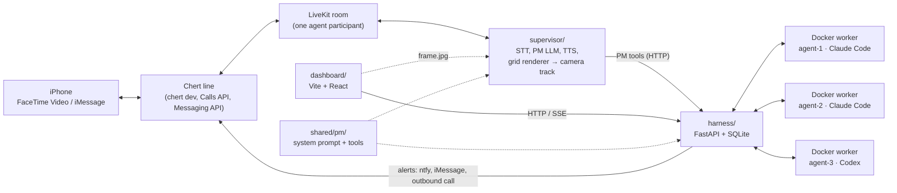

# Eris

**Mission control for your team of coding agents — watch them work and talk to them face to face over FaceTime.**

Built for HackUTA 2026 (Chert track).

Eris runs three headless coding agents in Docker and puts a **PM agent** in front of them. You reach the PM by FaceTime
video, text, or the web dashboard. On a FaceTime call, the PM's outgoing video is a live view of your whole team.

## What it does

- **Call in on FaceTime Video.** The PM greets you with a recap of the last call and what needs attention, then you see a live
  grid of three worker agents (state, task, latest activity). "Show me agent 2" switches to a full-screen view of that agent.
- **Talk to the team.** Ask for status, tell an agent what to do ("tell agent 1 to use the v2 endpoint"), pause or resume an agent,
  create tasks, search past conversations, and stop everything with one phrase.
- **Get alerted when a worker is stuck.** The harness texts you (ntfy, and iMessage with a picture of the grid) and can call
  you on FaceTime; the call opens with the reason.
- **Approve risky actions by voice.** A worker that wants to `git push` stops and asks; nothing is pushed until you say yes.
- **Continue anywhere.** Every call and chat is saved with transcript, actions and a summary. The PM remembers recent calls, and the
  dashboard can resume any conversation in a chat panel that uses the same PM brain.
- **Dashboard** (Live, Conversations, Tasks with approvals, Settings with provider tests), served on `localhost:5173`.

## Architecture



- **One PM brain.** Voice (supervisor) and web chat (`/chat` in the harness) load the same `shared/pm/system_prompt.md` and
  `shared/pm/tools.json`, call the same harness routes, and log to the same tables.
- **One video track.** Chert allows one agent participant per room, so worker screens are drawn into the supervisor's single camera
  track (and mirrored at `:8788/frame.jpg` for the dashboard).
- **Workers are sandboxed.** Each runs in its own Docker container as a non-root user with only the demo repo mounted. Workers commit
  locally and have no push credentials; a push goes through an approval.
- The contract between the parts (schema, HTTP API, PM tools) is in [AGENTS.md](AGENTS.md).

## How Chert is used

| Piece | What Eris does with it |
|---|---|
| **Inbound FaceTime** | `chert dev` connects the supervisor to a Chert line. A FaceTime Video call arrives as a LiveKit room; the supervisor greets once when Chert reports `bridge_ready` and publishes both its voice and the team grid as one camera track. |
| **Outbound calls** | When a worker is stuck and alerts are set to call, the harness creates a LiveKit room, dispatches the supervisor into it, and places the call through Chert's Calls API (`customer_managed` mode). The greeting leads with the reason. |
| **iMessage alerts** | The harness sends the alert text through Chert's Messaging API, with the current frame from `:8788/frame.jpg` attached when available. |

The outbound call and iMessage paths are covered by tests with the HTTP calls mocked. They have not been exercised against a live
Chert line in this repo's tests; `docs/DEMO.md` has the one-command checks to run before relying on them.

## Quickstart

Needs Docker, Python 3.11+, Node 24 (not 26), the `chert` CLI, and API keys: Deepgram (speech), OpenAI (the PM), a LiveKit project, and
a Claude Code token for real workers. The full rehearsal runbook is [docs/DEMO.md](docs/DEMO.md).

```sh
# 1. Configure (never commit these; every variable is listed, values blank)
cp harness/.env.example harness/.env
cp supervisor/.env.example supervisor/.env.local

# 2. Worker images and the demo repo the agents work on
scripts/build-worker.sh && scripts/build-codex-worker.sh && scripts/make-demo-repo.sh

# 3. Start things, each in its own terminal
cd harness && python3 -m venv .venv && .venv/bin/pip install -r requirements.txt && .venv/bin/uvicorn app.main:app --port 8787
cd supervisor && npm install && npm start          # the PM; serves :8788/frame.jpg during a call
cd supervisor && chert login && chert dev --json    # puts the supervisor on your FaceTime line; wait for agent_warm
cd dashboard && npm install && npm run dev          # http://localhost:5173
```

With no `REAL_WORKERS` set, the three agents are mocks, so you can try the PM, the grid and the dashboard without Docker or worker keys.
Try the voice side without a phone in LiveKit's Agent Console (set `GREET_ON_JOIN=1` in `supervisor/.env.local`; do not run `chert dev`).
Real FaceTime calls need a Chert line, and the free trial is capped at 5 minutes per call.

## Tests

| Part | Command | Result when this was written |
|---|---|---|
| Harness | `cd harness && .venv/bin/pytest -q` | 335 passed |
| Supervisor | `cd supervisor && npm test` | 266 passed |
| Dashboard | `cd dashboard && npm run typecheck` | type-checks clean (no unit tests) |

The tests mock all network access: no model, Chert, LiveKit or Docker call is made. Real-worker runs and live calls are checked by hand
using [docs/DEMO.md](docs/DEMO.md).

## Repo layout

| Path | What it is |
|---|---|
| `shared/pm/` | PM system prompt and tool schemas, used by voice and web |
| `supervisor/` | the PM on calls: LiveKit/Chert voice agent and the grid/focus renderer |
| `harness/` | FastAPI API, SQLite, worker control, stuck detection, alerts, web chat |
| `workers/` | Dockerfiles for the Claude Code and Codex workers |
| `dashboard/` | web UI (talks only to the harness) |
| `demo-template/` | source for the demo repo the workers edit (`scripts/make-demo-repo.sh` builds `demo-repo/`) |
| `docs/` | demo runbook and Devpost write-up |

## Team

| Name | Role | Links |
|---|---|---|
| _Your name_ | _e.g. supervisor / voice_ | _GitHub_ |
| _Your name_ | _e.g. harness / workers_ | _GitHub_ |
| _Your name_ | _e.g. dashboard / design_ | _GitHub_ |

## License

[MIT](LICENSE)
